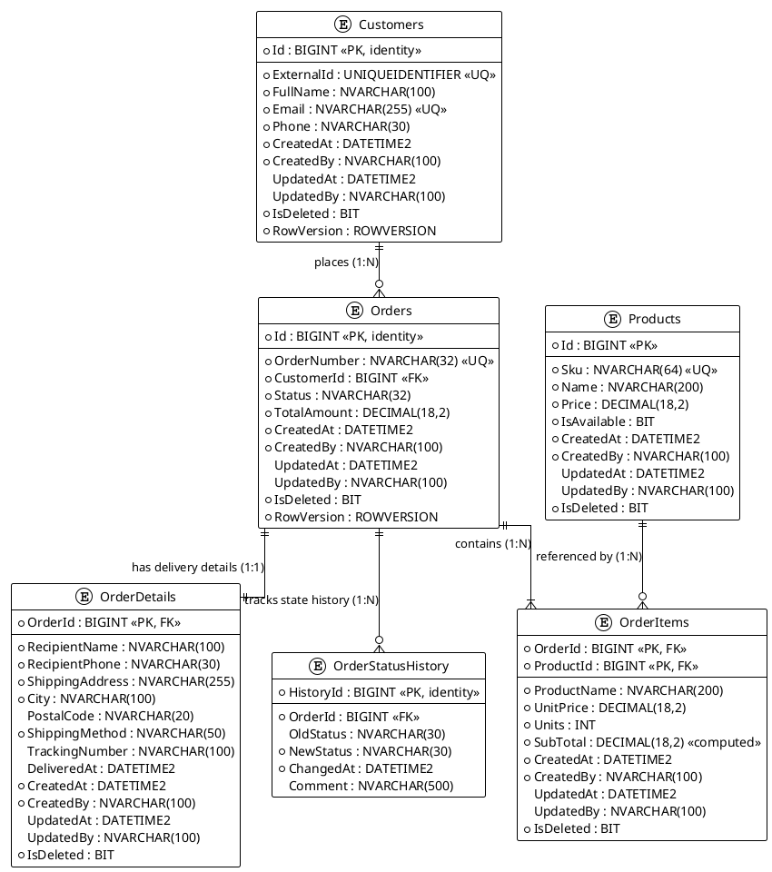
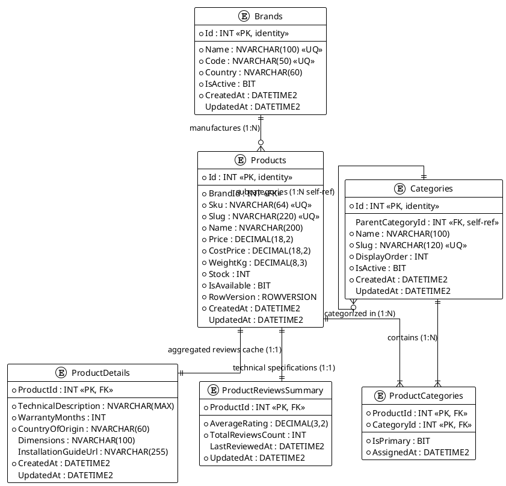

# AutoParts & Tools E-Commerce Platform

Enterprise distributed e-commerce platform for auto parts and professional tools retail, designed with polyglot persistence (Microsoft SQL Server and MongoDB) and clean 3-tier architecture (.NET 8, ADO.NET, Dapper, and .NET Aspire).

---

## Architecture Overview

The system is separated into three bounded contexts following Domain-Driven Design (DDD):

1. **Ordering Context (`db/p1`, `Services/Orders`):** Microsoft SQL Server OLTP database and .NET 3-tier service handling order lifecycle, line items, state transitions with row locking, price snapshotting, and stock decrease.
2. **Catalog Context (`db/p2`):** Microsoft SQL Server database designed for Entity Framework Core managing products, brands, self-referencing categories, and payload-rich M:N category assignments.
3. **Reviews Context (`db/p3`):** MongoDB document store managing customer feedback, multi-tier rating breakdowns, threaded discussions, and flexible polymorphic review structures.

---

## Entity-Relationship Diagrams (ERD)

### Project 1: Ordering Service Database
- PlantUML: [docs/erd-p1.puml](docs/erd-p1.puml)



### Project 2: Catalog Service Database
- PlantUML: [docs/erd-p2.puml](docs/erd-p2.puml)



---

## Data Consistency and Duplication Matrix

| Duplicated Field | Source of Truth | Destination Context | Storage Target | Pattern | Consistency Guarantee |
| :--- | :--- | :--- | :--- | :--- | :--- |
| `ProductName`, `UnitPrice` | `CatalogDb.dbo.Products` | Ordering Context (P1) | `dbo.OrderItems` | Snapshot | Immutable snapshot upon order item insertion |
| `RecipientName`, `ShippingAddress` | Customer Profile | Ordering Context (P1) | `dbo.OrderDetails` | Snapshot | Immutable delivery snapshot |
| `productName` | `CatalogDb.dbo.Products` | Reviews Context (P3) | `reviews` collection | Denormalization | Eventual consistency via integration events |
| `AverageRating`, `TotalReviewsCount` | Reviews Context (P3) | Catalog Context (P2) | `dbo.ProductReviewsSummary` | Read Projection | Eventual consistency via async review events |

---

## Repository and Solution Structure

```text
.
├── Platform.sln                       # Classic solution file registering all projects
├── Platform.slnx                      # Modern XML-based solution file (.NET 9+)
├── Platform.AppHost/                  # Aspire Orchestration AppHost (.NET 8/9)
│   ├── Program.cs                     # Service discovery and container orchestration
│   ├── appsettings.json               # Connection strings and configuration
│   └── Platform.AppHost.csproj
├── Services/
│   └── Orders/
│       ├── Orders.Domain/             # Pure domain models and domain exceptions
│       │   ├── Entities/              # Customer, Order, OrderDetails, Product, OrderItem, OrderStatusHistory
│       │   └── Exceptions/            # NotFoundException, BusinessConflictException, ValidationException
│       ├── Orders.Dal/                # Data Access Layer (ADO.NET + Dapper + Unit of Work)
│       │   ├── Repositories/          # Generic Repo, BaseDapperRepository, CustomerRepo (pure ADO.NET), OrderRepo, ProductRepo
│       │   ├── IUnitOfWork.cs
│       │   └── UnitOfWork.cs          # Single connection per scope, transaction coordinator
│       ├── Orders.Bll/                # Business Logic Layer (DTOs, AutoMapper, 2-level validation)
│       │   ├── DTOs/                  # CreateOrderDto, CreateOrderItemDto, OrderDto, OrderItemDto, CustomerDto
│       │   ├── Mapping/               # AutoMapper OrderProfile
│       │   └── Services/              # IOrderService, OrderService (transactional operations)
│       └── Orders.Api/                # Web API (thin controllers, Swagger, Serilog, ProblemDetails)
│           ├── Controllers/           # OrdersController (GET, POST, POST /confirm)
│           ├── Middleware/            # DomainExceptionHandler (IExceptionHandler -> RFC 7807 ProblemDetails)
│           ├── Program.cs
│           └── appsettings.json
├── docs/
│   ├── contexts.md
│   ├── duplication-policy.md
│   ├── erd-p1.puml
│   ├── erd-p2.puml
│   └── mongo-examples.json
└── db/
    ├── p1/
    │   ├── schema.sql
    │   ├── procedures.sql
    │   └── seed.sql
    ├── p2/
    │   ├── schema.sql
    │   └── seed.sql
    └── p3/
        ├── collections.js
        └── seed.js
```

---

## Laboratory Work #2: 3-Tier Architecture (.NET 8, ADO.NET, Dapper)

### 1. Architecture Design and Layer Responsibilities

The Orders Service is designed strictly following the 3-Tier Enterprise Architectural Pattern:

```
[ HTTP Client / Swagger / Aspire ]
                |
                v
       Orders.Api (Presentation)
  - Thin API Controller (OrdersController)
  - Attribute routing ([Route("api/orders")])
  - Global ProblemDetails Exception Handler (DomainExceptionHandler)
  - Serilog logging & Swagger OpenAPI
                |
                v
       Orders.Bll (Business Logic)
  - Two-level validation (DataAnnotations on DTO + BLL Business Rules)
  - DTO mapping via AutoMapper (OrderProfile)
  - Transactional workflows (OrderService.ConfirmOrderAsync)
  - Price Snapshotting upon Order creation
                |
                v
       Orders.Dal (Data Access)
  - Unit of Work pattern (IUnitOfWork, UnitOfWork) managing 1 SqlConnection
  - Pure ADO.NET (CustomerRepository: SqlCommand, SqlParameter, SqlDataReader)
  - Dapper Generic Repository (BaseDapperRepository<T>: parameterized SQL)
  - Dapper Multi-Mapping (OrderRepository.GetWithItemsAsync via QueryAsync)
  - Stored Procedure execution (OrderRepository.ConfirmAsync -> dbo.usp_ChangeOrderStatus)
                |
                v
       Orders.Domain (Core Entities)
  - Entity models matching database schema (Customer, Order, Product, etc.)
  - Domain exceptions (NotFoundException, BusinessConflictException, ValidationException)
```

### 2. How to Run the Application

#### Option A: Run via .NET Aspire AppHost (Recommended)

```powershell
# Run orchestrator
dotnet run --project Platform.AppHost
```
This automatically boots the Orders API service and launches the Aspire Developer Dashboard in your browser.

#### Option B: Run Orders.Api Directly

```powershell
# Run API directly
dotnet run --project Services/Orders/Orders.Api
```
The API starts on `http://localhost:5000` (or configured HTTPS port), and Swagger UI is accessible at `/swagger`.

---

### 3. API Verification with cURL

#### 1. Retrieve Order by ID (200 OK)
```bash
curl -X GET "http://localhost:5000/api/orders/1" \
     -H "Accept: application/json"
```

#### 2. Create a New Order (201 Created)
```bash
curl -X POST "http://localhost:5000/api/orders" \
     -H "Content-Type: application/json" \
     -d '{
       "customerId": 1,
       "items": [
         { "productId": 1, "units": 2 },
         { "productId": 2, "units": 1 }
       ],
       "shippingAddress": "вул. Хрещатик, 22, кв. 10",
       "city": "Київ",
       "postalCode": "01001"
     }'
```

#### 3. Confirm Order and Decrease Stock (204 No Content)
```bash
curl -X POST "http://localhost:5000/api/orders/1/confirm" \
     -H "Accept: application/json"
```

#### 4. Verification of Error Handling (ProblemDetails)
- **Non-existent Order:** `GET /api/orders/9999` returns `404 Not Found` with RFC 7807 JSON `ProblemDetails`.
- **Duplicate Confirmation:** Confirming an already confirmed order returns `409 Conflict`.
- **Validation Failure:** Negative `units` or missing items return `400 Bad Request`.

---

## Deployment and Verification Guide for Databases

### 1. Database Containers Setup

```bash
# Start Microsoft SQL Server 2022
docker run -e "ACCEPT_EULA=Y" -e "MSSQL_SA_PASSWORD=YourStrong@Passw0rd!" \
   -p 1433:1433 --name mssql-ecommerce -d mcr.microsoft.com/mssql/server:2022-latest

# Start MongoDB
docker run -p 27017:27017 --name mongo-ecommerce -d mongo:latest
```

---

### 2. Project 1 Deployment (Ordering DB - SQL Server)

```powershell
# Create Ordering database
sqlcmd -S localhost,1433 -U sa -P "YourStrong@Passw0rd!" -Q "IF NOT EXISTS (SELECT 1 FROM sys.databases WHERE name = 'OrderingDb') CREATE DATABASE OrderingDb;"

# Apply schema, stored procedures, and seed data
sqlcmd -S localhost,1433 -U sa -P "YourStrong@Passw0rd!" -d OrderingDb -i db/p1/schema.sql
sqlcmd -S localhost,1433 -U sa -P "YourStrong@Passw0rd!" -d OrderingDb -i db/p1/procedures.sql
sqlcmd -S localhost,1433 -U sa -P "YourStrong@Passw0rd!" -d OrderingDb -i db/p1/seed.sql
```

**Verification Queries:**
```sql
USE OrderingDb;

-- Test status transition with row locking
EXEC dbo.usp_ChangeOrderStatus 
    @OrderId = 1, 
    @NewStatus = N'Paid', 
    @Comment = N'Payment confirmed via LiqPay';

-- Inspect order status and audit history
SELECT Id, OrderNumber, Status, TotalAmount, RowVersion FROM dbo.Orders WHERE Id = 1;
SELECT * FROM dbo.OrderStatusHistory WHERE OrderId = 1 ORDER BY ChangedAt ASC;
```

---

### 3. Project 2 Deployment (Catalog DB - SQL Server for EF Core)

```powershell
# Create Catalog database
sqlcmd -S localhost,1433 -U sa -P "YourStrong@Passw0rd!" -Q "IF NOT EXISTS (SELECT 1 FROM sys.databases WHERE name = 'CatalogDb') CREATE DATABASE CatalogDb;"

# Apply schema and seed data
sqlcmd -S localhost,1433 -U sa -P "YourStrong@Passw0rd!" -d CatalogDb -i db/p2/schema.sql
sqlcmd -S localhost,1433 -U sa -P "YourStrong@Passw0rd!" -d CatalogDb -i db/p2/seed.sql
```

**Verification Queries:**
```sql
USE CatalogDb;

-- Verify M:N payload relationship with IsPrimary and AssignedAt
SELECT 
    p.Sku,
    p.Name AS ProductName,
    c.Name AS CategoryName,
    pc.IsPrimary,
    pc.AssignedAt
FROM dbo.ProductCategories pc
INNER JOIN dbo.Products p ON pc.ProductId = p.Id
INNER JOIN dbo.Categories c ON pc.CategoryId = c.Id;
```

---

### 4. Project 3 Deployment (Reviews DB - MongoDB)

```powershell
# Initialize collections, validation schemas, and indexes
mongosh "mongodb://localhost:27017" db/p3/collections.js

# Load idempotent seed documents
mongosh "mongodb://localhost:27017" db/p3/seed.js
```

**Verification Queries:**
```mongodb
use ReviewsServiceDb;

// Query polymorphic review document with embedded comments and referenced discussion
db.reviews.find({ productId: 1 }).pretty();

// Query minimal review document
db.reviews.find({ productId: 2 }).pretty();
```
