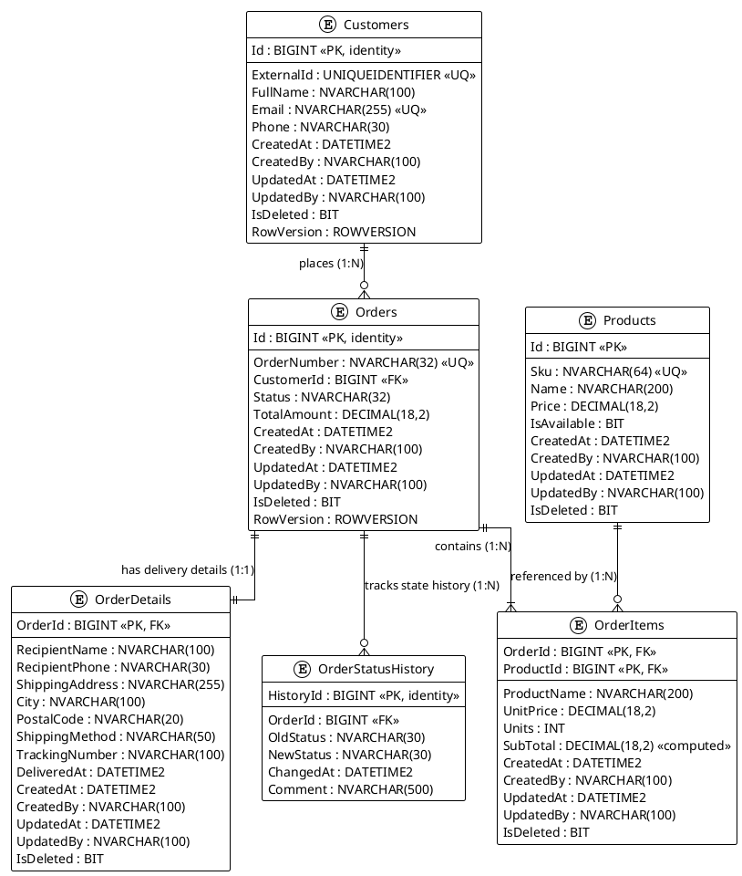
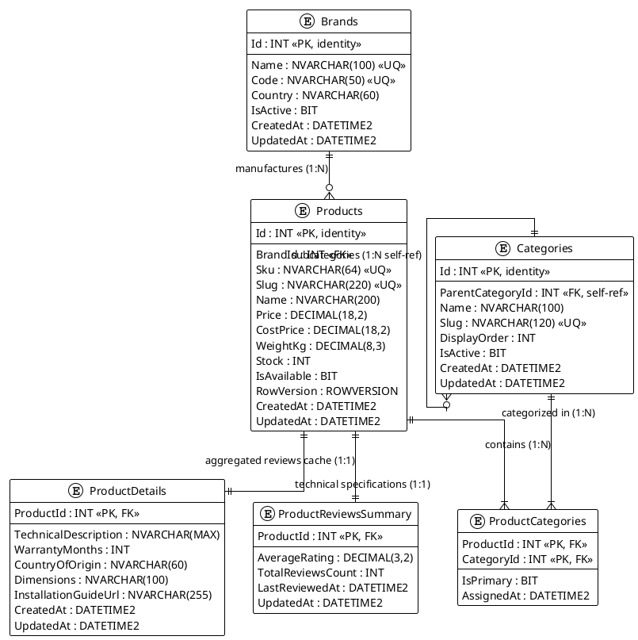

# AutoParts & Tools E-Commerce Platform

Enterprise database design for distributed auto parts and tools retail system built with polyglot persistence (SQL Server and MongoDB).

---

## Architecture Overview

The system is separated into three bounded contexts following Domain-Driven Design (DDD):

1. **Ordering Context (`db/p1`):** Microsoft SQL Server OLTP database handling order intake, state machine transitions, line items, and delivery metadata.
2. **Catalog Context (`db/p2`):** Microsoft SQL Server database designed for Entity Framework Core managing products, brands, self-referencing categories, and payload-rich M:N category assignments.
3. **Reviews Context (`db/p3`):** MongoDB document store managing customer feedback, multi-tier rating breakdowns, threaded discussions, and flexible review structures.

---

## Entity-Relationship Diagrams (ERD)

### Project 1: Ordering Service Database
- **PlantUML File:** [docs/erd-p1.puml](docs/erd-p1.puml)



---

### Project 2: Catalog Service Database
- **PlantUML File:** [docs/erd-p2.puml](docs/erd-p2.puml)



---

## Data Consistency and Duplication Matrix

| Duplicated Field | Source of Truth | Destination Context | Storage Target | Pattern | Consistency Guarantee |
| :--- | :--- | :--- | :--- | :--- | :--- |
| `ProductName`, `UnitPrice` | `CatalogDb.dbo.Products` | Ordering Context (P1) | `dbo.OrderItems` | Snapshot | Immutable snapshot upon order item insertion |
| `RecipientName`, `ShippingAddress` | Customer Profile | Ordering Context (P1) | `dbo.OrderDetails` | Snapshot | Immutable delivery snapshot |
| `productName` | `CatalogDb.dbo.Products` | Reviews Context (P3) | `reviews` collection | Denormalization | Eventual consistency via integration events |
| `AverageRating`, `TotalReviewsCount` | Reviews Context (P3) | Catalog Context (P2) | `dbo.ProductReviewsSummary` | Read Projection | Eventual consistency via async review events |

---

## Repository Structure

```text
.
├── README.md
├── docs/
│   ├── contexts.md
│   ├── duplication-policy.md
│   ├── erd-p1.puml
│   ├── erd-p2.puml
│   └── mongo-examples.json
└── db/
    ├── p1/
    │   ├── schema.sql
    │   ├── procedures.sql
    │   └── seed.sql
    ├── p2/
    │   ├── schema.sql
    │   └── seed.sql
    └── p3/
        ├── collections.js
        └── seed.js
```

---

## Deployment and Verification Guide

### 1. Database Containers Setup

```bash
# Start Microsoft SQL Server 2022
docker run -e "ACCEPT_EULA=Y" -e "MSSQL_SA_PASSWORD=YourStrong@Passw0rd!" \
   -p 1433:1433 --name mssql-ecommerce -d [mcr.microsoft.com/mssql/server:2022-latest](https://mcr.microsoft.com/mssql/server:2022-latest)

# Start MongoDB
docker run -p 27017:27017 --name mongo-ecommerce -d mongo:latest
```

---

### 2. Project 1 Deployment (Ordering DB - SQL Server)

```powershell
# Create Ordering database
sqlcmd -S localhost,1433 -U sa -P "YourStrong@Passw0rd!" -Q "IF NOT EXISTS (SELECT 1 FROM sys.databases WHERE name = 'OrderingDb') CREATE DATABASE OrderingDb;"

# Apply schema, stored procedures, and seed data
sqlcmd -S localhost,1433 -U sa -P "YourStrong@Passw0rd!" -d OrderingDb -i db/p1/schema.sql
sqlcmd -S localhost,1433 -U sa -P "YourStrong@Passw0rd!" -d OrderingDb -i db/p1/procedures.sql
sqlcmd -S localhost,1433 -U sa -P "YourStrong@Passw0rd!" -d OrderingDb -i db/p1/seed.sql
```

**Verification Queries:**
```sql
USE OrderingDb;

-- Test status transition with row locking
EXEC dbo.usp_ChangeOrderStatus 
    @OrderId = 1, 
    @NewStatus = N'Paid', 
    @Comment = N'Payment confirmed via LiqPay';

-- Inspect order status and audit history
SELECT Id, OrderNumber, Status, TotalAmount, RowVersion FROM dbo.Orders WHERE Id = 1;
SELECT * FROM dbo.OrderStatusHistory WHERE OrderId = 1 ORDER BY ChangedAt ASC;
```

---

### 3. Project 2 Deployment (Catalog DB - SQL Server for EF Core)

```powershell
# Create Catalog database
sqlcmd -S localhost,1433 -U sa -P "YourStrong@Passw0rd!" -Q "IF NOT EXISTS (SELECT 1 FROM sys.databases WHERE name = 'CatalogDb') CREATE DATABASE CatalogDb;"

# Apply schema and seed data
sqlcmd -S localhost,1433 -U sa -P "YourStrong@Passw0rd!" -d CatalogDb -i db/p2/schema.sql
sqlcmd -S localhost,1433 -U sa -P "YourStrong@Passw0rd!" -d CatalogDb -i db/p2/seed.sql
```

**Verification Queries:**
```sql
USE CatalogDb;

-- Verify M:N payload relationship with IsPrimary and AssignedAt
SELECT 
    p.Sku,
    p.Name AS ProductName,
    c.Name AS CategoryName,
    pc.IsPrimary,
    pc.AssignedAt
FROM dbo.ProductCategories pc
INNER JOIN dbo.Products p ON pc.ProductId = p.Id
INNER JOIN dbo.Categories c ON pc.CategoryId = c.Id;
```

---

### 4. Project 3 Deployment (Reviews DB - MongoDB)

```powershell
# Initialize collections, validation schemas, and indexes
mongosh "mongodb://localhost:27017" db/p3/collections.js

# Load idempotent seed documents
mongosh "mongodb://localhost:27017" db/p3/seed.js
```

**Verification Queries:**
```mongodb
use ReviewsServiceDb;

// Query polymorphic review document with embedded comments and referenced discussion
db.reviews.find({ productId: 1 }).pretty();

// Query minimal review document
db.reviews.find({ productId: 2 }).pretty();
```