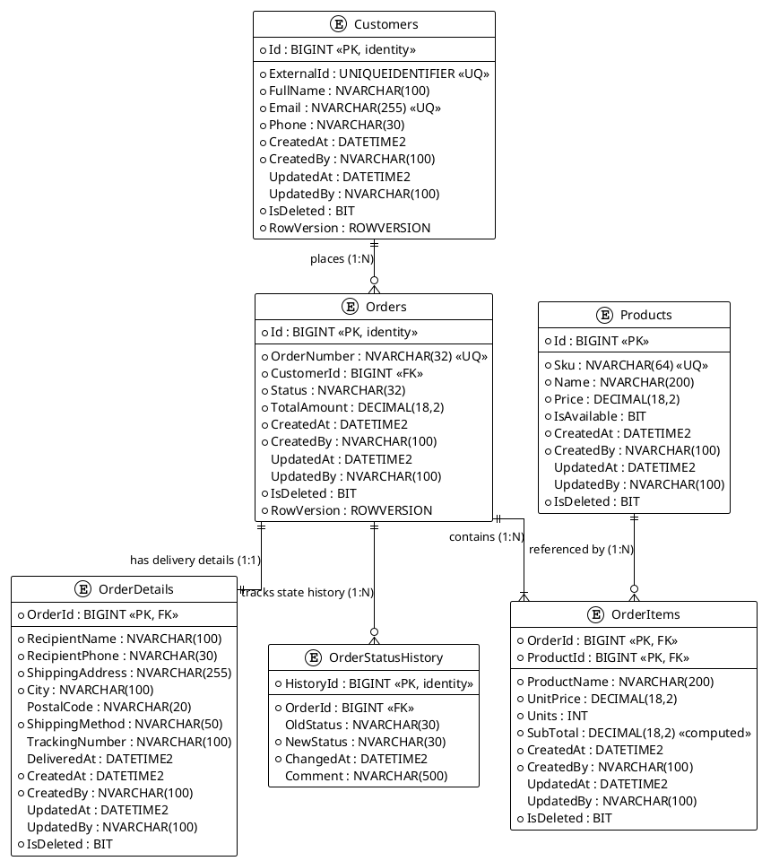
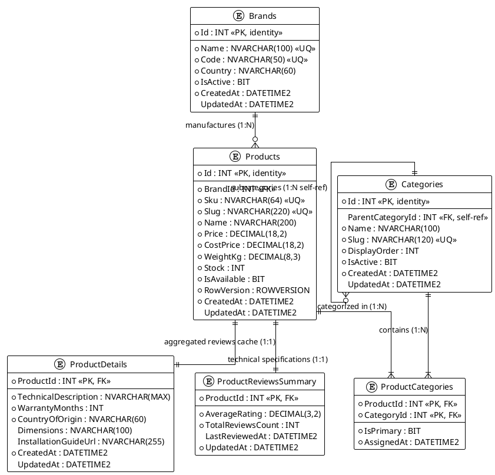

# AutoParts & Tools E-Commerce Platform

Enterprise distributed e-commerce platform for auto parts and professional tools retail, designed with polyglot persistence (Microsoft SQL Server and MongoDB) and clean 3-tier architecture (.NET 8, ADO.NET, Dapper, and .NET Aspire).

---

## Architecture Overview

The system is separated into three bounded contexts following Domain-Driven Design (DDD):

1. **Ordering Context (`db/p1`, `Services/Orders`):** Microsoft SQL Server OLTP database and .NET 3-tier service handling order lifecycle, line items, state transitions with row locking, price snapshotting, and stock decrease.
2. **Catalog Context (`db/p2`):** Microsoft SQL Server database designed for Entity Framework Core managing products, brands, self-referencing categories, and payload-rich M:N category assignments.
3. **Reviews Context (`db/p3`):** MongoDB document store managing customer feedback, multi-tier rating breakdowns, threaded discussions, and flexible polymorphic review structures.

---

## Entity-Relationship Diagrams (ERD)

### Project 1: Ordering Service Database
- PlantUML: [docs/erd-p1.puml](docs/erd-p1.puml)



### Project 2: Catalog Service Database
- PlantUML: [docs/erd-p2.puml](docs/erd-p2.puml)



---

## Data Consistency and Duplication Matrix

| Duplicated Field | Source of Truth | Destination Context | Storage Target | Pattern | Consistency Guarantee |
| :--- | :--- | :--- | :--- | :--- | :--- |
| `ProductName`, `UnitPrice` | `CatalogDb.dbo.Products` | Ordering Context (P1) | `dbo.OrderItems` | Snapshot | Immutable snapshot upon order item insertion |
| `RecipientName`, `ShippingAddress` | Customer Profile | Ordering Context (P1) | `dbo.OrderDetails` | Snapshot | Immutable delivery snapshot |
| `productName` | `CatalogDb.dbo.Products` | Reviews Context (P3) | `reviews` collection | Denormalization | Eventual consistency via integration events |
| `AverageRating`, `TotalReviewsCount` | Reviews Context (P3) | Catalog Context (P2) | `dbo.ProductReviewsSummary` | Read Projection | Eventual consistency via async review events |

---

## Repository and Solution Structure

```text
.
├── Platform.sln                       # Classic solution file registering all projects
├── Platform.slnx                      # Modern XML-based solution file (.NET 9+)
├── Platform.AppHost/                  # Aspire Orchestration AppHost (.NET 8/9)
│   ├── Program.cs                     # Service discovery and container orchestration
│   ├── appsettings.json               # Connection strings and configuration
│   └── Platform.AppHost.csproj
├── Services/
│   ├── Catalog/                       # Lab 03: EF Core 3-tier Catalog Microservice
│   │   ├── Catalog.Domain/            # Rich Domain Entities, Encapsulated Invariants & Domain Exceptions
│   │   │   ├── Entities/              # Product, Brand, Category, ProductDetails, ProductCategory, ProductImage
│   │   │   └── Exceptions/            # DomainException, EntityNotFoundException, ConflictException
│   │   ├── Catalog.Dal/               # EF Core DbContext, Configurations, Repositories, UoW & Migrations
│   │   │   ├── Configurations/        # Product, Brand, Category, ProductDetails, ProductCategory, ProductImage
│   │   │   ├── Migrations/            # EF Core InitialCreate & Idempotent SQL script
│   │   │   ├── Repositories/          # Generic Repo, ProductRepo (Eager, Explicit, LINQ M:N), BrandRepo, CategoryRepo
│   │   │   ├── Specifications/        # ISpecification, BaseSpecification, SpecificationEvaluator
│   │   │   ├── CatalogDbContext.cs
│   │   │   ├── DbInitializer.cs       # Programmatic idempotent seeding
│   │   │   ├── IUnitOfWork.cs
│   │   │   └── UnitOfWork.cs
│   │   ├── Catalog.Bll/               # Business Logic Layer (Services, DTOs, AutoMapper, FluentValidation, Specifications)
│   │   │   ├── Common/                # PagedResult, ProductQueryParams
│   │   │   ├── Dtos/                  # ProductDto, CreateProductDto, UpdateProductDto, BrandDto, CategoryDto
│   │   │   ├── Mapping/               # AutoMapper CatalogMappingProfile
│   │   │   ├── Services/              # ProductService, BrandService, CategoryService (via IUnitOfWork)
│   │   │   ├── Specifications/        # ProductFilterPaginatedSpec, ProductFilterCountSpec
│   │   │   └── Validators/            # FluentValidation Validators
│   │   └── Catalog.Api/               # ASP.NET Core Web API (Controllers, Swagger, Serilog, ProblemDetails)
│   │       ├── Controllers/           # ProductsController, BrandsController, CategoriesController
│   │       ├── Middleware/            # CatalogExceptionHandler (RFC 7807 ProblemDetails)
│   │       ├── Program.cs
│   │       └── appsettings.json
│   └── Orders/
│       ├── Orders.Domain/             # Pure domain models and domain exceptions
│       │   ├── Entities/              # Customer, Order, OrderDetails, Product, OrderItem, OrderStatusHistory
│       │   └── Exceptions/            # NotFoundException, BusinessConflictException, ValidationException
│       ├── Orders.Dal/                # Data Access Layer (ADO.NET + Dapper + Unit of Work)
│       │   ├── Repositories/          # Generic Repo, BaseDapperRepository, CustomerRepo (pure ADO.NET), OrderRepo, ProductRepo
│       │   ├── IUnitOfWork.cs
│       │   └── UnitOfWork.cs          # Single connection per scope, transaction coordinator
│       ├── Orders.Bll/                # Business Logic Layer (DTOs, AutoMapper, 2-level validation)
│       │   ├── DTOs/                  # CreateOrderDto, CreateOrderItemDto, OrderDto, OrderItemDto, CustomerDto
│       │   ├── Mapping/               # AutoMapper OrderProfile
│       │   └── Services/              # IOrderService, OrderService (transactional operations)
│       └── Orders.Api/                # Web API (thin controllers, Swagger, Serilog, ProblemDetails)
│           ├── Controllers/           # OrdersController (GET, POST, POST /confirm)
│           ├── Middleware/            # DomainExceptionHandler (IExceptionHandler -> RFC 7807 ProblemDetails)
│           ├── Program.cs
│           └── appsettings.json
│   └── Reviews/                       # Lab 04: Clean Architecture MongoDB Microservice (CQRS + Mediator)
│       ├── Reviews.Domain/            # BaseEntity, ValueObject, Review, Comment, Author, RatingScore
│       │   ├── Common/                # BaseEntity, ValueObject
│       │   ├── Entities/              # Review, Comment
│       │   ├── Exceptions/            # DomainException, EntityNotFoundException, ConflictException
│       │   ├── Repositories/          # IReviewRepository
│       │   └── ValueObjects/          # Author, RatingScore
│       ├── Reviews.Application/       # CQRS Commands/Queries, MediatR Behaviors, FluentValidation
│       │   ├── Common/                # Behaviors (Logging, Validation, Performance), Interfaces (ICommand, IQuery, IReviewQueries)
│       │   ├── DTOs/                  # ReviewDto, AuthorDto, CommentDto
│       │   ├── Features/Reviews/      # Commands (Create, Update, Delete, AddComment), Queries (GetById, GetList)
│       │   └── DependencyInjection.cs
│       ├── Reviews.Infrastructure/    # MongoDB Driver, BsonClassMap, Repositories, Seeder, Indexes
│       │   ├── Configuration/         # MongoDbOptions
│       │   ├── Persistence/           # MongoDbContext, MongoMappings (Class Maps & Conventions)
│       │   ├── Queries/               # ReviewQueries (MongoDB Driver aggregation/pagination)
│       │   ├── Repositories/          # ReviewRepository (Optimistic concurrency with Version)
│       │   ├── Services/              # ReviewSeeder, IndexCreationService (Background indexer)
│       │   └── DependencyInjection.cs
│       └── Reviews.WebApi/            # ASP.NET Core Web API (Thin controller with ISender, ProblemDetails)
│           ├── Controllers/           # ReviewsController
│           ├── Middleware/            # ReviewsExceptionHandler (MongoDB exception mapping)
│           ├── Mapping/               # ReviewProfile (AutoMapper)
│           ├── Models/Requests/       # CreateReviewRequest, UpdateReviewRequest, AddCommentRequest
│           ├── Program.cs
│           └── appsettings.json
├── docs/
│   ├── contexts.md
│   ├── duplication-policy.md
│   ├── erd-p1.puml
│   ├── erd-p2.puml
│   └── mongo-examples.json
└── db/
    ├── p1/
    │   ├── schema.sql
    │   ├── procedures.sql
    │   └── seed.sql
    ├── p2/
    │   ├── schema.sql
    │   └── seed.sql
    └── p3/
        ├── collections.js
        └── seed.js
```

---

## Laboratory Work #2: 3-Tier Architecture (.NET 8, ADO.NET, Dapper)

### 1. Architecture Design and Layer Responsibilities

The Orders Service is designed strictly following the 3-Tier Enterprise Architectural Pattern:

```
[ HTTP Client / Swagger / Aspire ]
                |
                v
       Orders.Api (Presentation)
  - Thin API Controller (OrdersController)
  - Attribute routing ([Route("api/orders")])
  - Global ProblemDetails Exception Handler (DomainExceptionHandler)
  - Serilog logging & Swagger OpenAPI
                |
                v
       Orders.Bll (Business Logic)
  - Two-level validation (DataAnnotations on DTO + BLL Business Rules)
  - DTO mapping via AutoMapper (OrderProfile)
  - Transactional workflows (OrderService.ConfirmOrderAsync)
  - Price Snapshotting upon Order creation
                |
                v
       Orders.Dal (Data Access)
  - Unit of Work pattern (IUnitOfWork, UnitOfWork) managing 1 SqlConnection
  - Pure ADO.NET (CustomerRepository: SqlCommand, SqlParameter, SqlDataReader)
  - Dapper Generic Repository (BaseDapperRepository<T>: parameterized SQL)
  - Dapper Multi-Mapping (OrderRepository.GetWithItemsAsync via QueryAsync)
  - Stored Procedure execution (OrderRepository.ConfirmAsync -> dbo.usp_ChangeOrderStatus)
                |
                v
       Orders.Domain (Core Entities)
  - Entity models matching database schema (Customer, Order, Product, etc.)
  - Domain exceptions (NotFoundException, BusinessConflictException, ValidationException)
```

### 2. How to Run the Application

#### Option A: Run via .NET Aspire AppHost (Recommended)

```powershell
# Run orchestrator
dotnet run --project Platform.AppHost
```
This automatically boots the Orders API service and launches the Aspire Developer Dashboard in your browser.

#### Option B: Run Orders.Api Directly

```powershell
# Run API directly
dotnet run --project Services/Orders/Orders.Api
```
The API starts on `http://localhost:5000` (or configured HTTPS port), and Swagger UI is accessible at `/swagger`.

---

### 3. API Verification with cURL

#### 1. Retrieve Order by ID (200 OK)
```bash
curl -X GET "http://localhost:5000/api/orders/1" \
     -H "Accept: application/json"
```

#### 2. Create a New Order (201 Created)
```bash
curl -X POST "http://localhost:5000/api/orders" \
     -H "Content-Type: application/json" \
     -d '{
       "customerId": 1,
       "items": [
         { "productId": 1, "units": 2 },
         { "productId": 2, "units": 1 }
       ],
       "shippingAddress": "вул. Хрещатик, 22, кв. 10",
       "city": "Київ",
       "postalCode": "01001"
     }'
```

#### 3. Confirm Order and Decrease Stock (204 No Content)
```bash
curl -X POST "http://localhost:5000/api/orders/1/confirm" \
     -H "Accept: application/json"
```

#### 4. Verification of Error Handling (ProblemDetails)
- **Non-existent Order:** `GET /api/orders/9999` returns `404 Not Found` with RFC 7807 JSON `ProblemDetails`.
- **Duplicate Confirmation:** Confirming an already confirmed order returns `409 Conflict`.
- **Validation Failure:** Negative `units` or missing items return `400 Bad Request`.

---

## Laboratory Work #3: 3-Tier Architecture on Entity Framework Core

### 1. Architecture Design and Layer Responsibilities

The Catalog Service is built on Entity Framework Core (.NET 8) strictly adhering to domain-driven principles and 14 automated verification criteria:

```
[ HTTP Client / Swagger / Aspire ]
                |
                v
       Catalog.Api (Presentation)
  - Thin API Controllers ([Route("api/[controller]")])
  - Async action methods (Task<ActionResult<T>>)
  - Standard HTTP statuses (200, 201 CreatedAtAction, 204, 400, 404, 409)
  - Global ProblemDetails Exception Handler (CatalogExceptionHandler: IExceptionHandler)
  - Serilog structured logging with EF command level override
  - Swagger OpenAPI interactive documentation
                |
                v
       Catalog.Bll (Business Logic)
  - Exclusively operates through IUnitOfWork (no direct DbContext)
  - Specification Pattern integration (ProductFilterPaginatedSpec, ProductFilterCountSpec)
  - SQL-level pagination, filtering and dynamic sorting
  - FluentValidation integration (AbstractValidator<T>) + DataAnnotations
  - AutoMapper profiles (CatalogMappingProfile)
  - Database-level rule validations throwing EntityNotFoundException & ConflictException
                |
                v
       Catalog.Dal (Data Access)
  - CatalogDbContext applying IEntityTypeConfiguration<T> from assembly
  - Explicit relationships: 1:1 (PK=FK), 1:N (Cascade), M:N (Junction with AddedAt payload)
  - Check constraints (CK_Products_Price, CK_Products_Stock, etc.) & Unique indexes
  - Async Generic Repository (IGenericRepository<T>, GenericRepository<T>)
  - Unit of Work (IUnitOfWork, UnitOfWork) controlling SaveChangesAsync boundary
  - 3 Specific Repositories:
      1. Eager Loading (.Include + .ThenInclude single query)
      2. Explicit Loading (.Entry().Collection().Query().LoadAsync())
      3. LINQ to Entities M:N query (filtered & sorted by junction AddedAt)
  - Static seeding (HasData) & Programmatic seeding (DbInitializer.SeedAsync)
  - InitialCreate migration & Idempotent SQL migration script (InitialCreate.sql)
                |
                v
       Catalog.Domain (Domain Entities)
  - Encapsulated business rules: private setters, private parameterless constructors
  - Public constructors with invariant checks throwing DomainException
  - State mutations strictly through domain methods (UpdatePrice, AddStock, RemoveStock)
  - Domain exceptions: DomainException, EntityNotFoundException, ConflictException
```

### 2. How to Run Catalog Service

#### Option A: Run via .NET Aspire AppHost

```powershell
dotnet run --project Platform.AppHost
```

#### Option B: Run Catalog.Api Directly

```powershell
dotnet run --project Services/Catalog/Catalog.Api
```

Swagger UI will be available at: `http://localhost:5000/swagger` (or configured HTTPS port).

---

### 3. API Verification with cURL

#### 1. SQL-Level Paginated, Filtered & Sorted Query (200 OK)
```bash
curl -X GET "http://localhost:5000/api/products?page=1&pageSize=10&sortBy=price&sortDescending=false" \
     -H "Accept: application/json"
```

#### 2. Eager Loading Full Aggregate (200 OK)
```bash
curl -X GET "http://localhost:5000/api/products/1" \
     -H "Accept: application/json"
```

#### 3. Explicit Loading Demonstration (200 OK)
```bash
curl -X GET "http://localhost:5000/api/products/1/explicit" \
     -H "Accept: application/json"
```

#### 4. LINQ M:N Junction Query by AddedAt (200 OK)
```bash
curl -X GET "http://localhost:5000/api/products/categories/2/recent?days=30" \
     -H "Accept: application/json"
```

#### 5. Create Product (201 Created with Location Header)
```bash
curl -X POST "http://localhost:5000/api/products" \
     -H "Content-Type: application/json" \
     -d '{
       "brandId": 1,
       "sku": "MOT-300V-15W50-2L",
       "slug": "motul-300v-competition-15w50-2l",
       "name": "Моторна олива Motul 300V 15W-50 2л",
       "price": 1450.00,
       "costPrice": 980.00,
       "weightKg": 1.950,
       "stock": 25,
       "isAvailable": true,
       "categoryIds": [1, 2],
       "primaryCategoryId": 2,
       "details": {
         "technicalDescription": "100% синтетична спортивна олива з технологією ESTER Core.",
         "warrantyMonths": 60,
         "countryOfOrigin": "France"
       }
     }'
```

#### 6. Update Price via Domain Method (200 OK)
```bash
curl -X PATCH "http://localhost:5000/api/products/1/price" \
     -H "Content-Type: application/json" \
     -d '{
       "price": 1950.00,
       "costPrice": 1400.00
     }'
```

#### 7. Update Stock via Domain Method (200 OK)
```bash
curl -X PATCH "http://localhost:5000/api/products/1/stock" \
     -H "Content-Type: application/json" \
     -d '{
       "quantity": 10,
       "operation": "add"
     }'
```

#### 8. Verification of Error Handling (RFC 7807 ProblemDetails)
- **404 Not Found:** `GET /api/products/9999` returns `404 Not Found` with `EntityNotFoundException` mapped to ProblemDetails.
- **409 Conflict:** Creating a product with duplicate SKU returns `409 Conflict` with `ConflictException`.
- **400 Validation Problem:** Passing negative price or empty name returns `400 Bad Request` with `ValidationProblemDetails` containing field-level errors.

---

## Laboratory Work #4: Clean Architecture on MongoDB, CQRS & Mediator

### 1. Architecture Design and Layer Responsibilities

The Reviews Service is engineered strictly according to the Clean Architecture principles, CQRS pattern, and MediatR pipeline behaviors across 4 isolated projects:

```
[ HTTP Client / Swagger / Aspire ]
                |
                v
       Reviews.WebApi (Presentation)
  - Thin API Controller (ReviewsController) injecting ONLY ISender
  - Standard HTTP responses (200, 201 CreatedAtAction, 204, 400, 404, 409, 503)
  - ETag concurrency response header on GET /api/reviews/{id}
  - AutoMapper ReviewProfile for ObjectId <-> string conversion
  - Global ProblemDetails Exception Handler (ReviewsExceptionHandler: IExceptionHandler)
                |
                v
       Reviews.Application (Application Core)
  - CQRS Commands (CreateReview, UpdateReview, DeleteReview, AddComment) & Handlers
  - CQRS Queries (GetReviewById, GetReviewsList) & Handlers calling IReviewQueries
  - MediatR Pipeline Behaviors ordered strictly:
      1. LoggingBehavior (outer request/response logging)
      2. ValidationBehavior (FluentValidation validator execution before handler)
      3. PerformanceBehavior (Stopwatch > 500ms warning threshold)
  - FluentValidation rules with asynchronous MustAsync uniqueness checks
                |
                v
       Reviews.Infrastructure (Persistence & External Services)
  - MongoDB C# Driver integration via MongoDbContext & MongoDbOptions
  - Class Maps & Conventions configuration (MongoMappings.Register: zero BSON attributes in Domain)
  - ReviewRepository implementing optimistic concurrency via Version field
  - ReviewQueries implementing native driver aggregation, sorting, and pagination ($match, $skip, $limit)
  - Background indexer (IndexCreationService: compound, text, and unique sparse indexes)
  - Idempotent database seeder (ReviewSeeder)
                |
                v
       Reviews.Domain (Enterprise Domain Core)
  - BaseEntity (ObjectId Id, CreatedAt, UpdatedAt, Version, Touch, BumpVersion)
  - Aggregate Root Review with encapsulated invariants and domain methods
  - Entity Comment with private constructors and business encapsulation
  - Base class ValueObject with GetEqualityComponents()
  - Immutable Value Objects: Author, RatingScore
  - Repository abstraction: IReviewRepository (no MongoDB Driver dependencies)
```

### 2. How to Run Reviews Service

#### Option A: Run via .NET Aspire AppHost

```powershell
dotnet run --project Platform.AppHost
```

#### Option B: Run Reviews.WebApi Directly

```powershell
dotnet run --project Services/Reviews/Reviews.WebApi
```

Swagger UI will be available at: `http://localhost:5000/swagger` (or configured port).

---

### 3. API Verification with cURL

#### 1. Retrieve Paginated Reviews List with Product Filter (200 OK)
```bash
curl -X GET "http://localhost:5000/api/reviews?productId=1&page=1&pageSize=10" \
     -H "Accept: application/json"
```

#### 2. Retrieve Single Review by ObjectId with ETag Header (200 OK)
```bash
curl -i -X GET "http://localhost:5000/api/reviews/66f00101a1b2c3d4e5f60002" \
     -H "Accept: application/json"
```

#### 3. Create a New Review (201 Created with Location Header)
```bash
curl -X POST "http://localhost:5000/api/reviews" \
     -H "Content-Type: application/json" \
     -d '{
       "productId": 1,
       "productName": "Моторна олива Motul 8100 X-cess Gen2 5W-40 5л",
       "rating": 5,
       "headline": "Відмінна якість та стабільний тиск",
       "content": "Використовую цю оливу вже третій сезон на дизельному авто. Сажовий фільтр чистий, двигун працює тихо.",
       "authorUserId": "E5B26E83-9FA3-4D9A-8C21-998877660099",
       "authorName": "Тарас Григорович",
       "authorEmail": "taras.hryhorovych@example.com",
       "isVerifiedBuyer": true,
       "photos": [
         "https://cdn.autoparts.ua/reviews/motul_bottle.jpg"
       ]
     }'
```

#### 4. Add a Comment to an Existing Review (201 Created)
```bash
curl -X POST "http://localhost:5000/api/reviews/66f00101a1b2c3d4e5f60002/comments" \
     -H "Content-Type: application/json" \
     -d '{
       "authorName": "AutoParts Support",
       "commentText": "Дякуємо за ваш розгорнутий відгук! Раді, що ви задоволені продукцією."
     }'
```

#### 5. Update Review with Optimistic Concurrency (204 No Content)
```bash
curl -X PUT "http://localhost:5000/api/reviews/66f00101a1b2c3d4e5f60002" \
     -H "Content-Type: application/json" \
     -d '{
       "rating": 4,
       "headline": "Оновлений відгук після 10000 км",
       "content": "Олива відпрацювала гідно, хоча під кінець інтервалу трохи потемнішала."
     }'
```

#### 6. Delete Review (204 No Content)
```bash
curl -X DELETE "http://localhost:5000/api/reviews/66f00101a1b2c3d4e5f60002" \
     -H "Accept: application/json"
```

#### 7. Verification of Error Handling (RFC 7807 ProblemDetails)
- **404 Not Found:** `GET /api/reviews/66f00101a1b2c3d4e5f69999` returns `404 Not Found` with RFC 7807 ProblemDetails.
- **400 Validation Error:** Submitting invalid rating (< 1 or > 5) or malformed ObjectId triggers `ValidationBehavior` and returns `400 Bad Request` with `ValidationProblemDetails`.
- **409 Conflict:** Submitting a duplicate review from the same author for the same product triggers `MustAsync` unique rule and returns `409 Conflict` (or Mongo duplicate key error). Concurrent modification conflict returns `409 Conflict`.
- **503 Service Unavailable:** Network disconnection from MongoDB cluster triggers `MongoConnectionException` and returns `503 Service Unavailable`.

---

## Deployment and Verification Guide for Databases

### 1. Database Containers Setup

```bash
# Start Microsoft SQL Server 2022
docker run -e "ACCEPT_EULA=Y" -e "MSSQL_SA_PASSWORD=YourStrong@Passw0rd!" \
   -p 1433:1433 --name mssql-ecommerce -d mcr.microsoft.com/mssql/server:2022-latest

# Start MongoDB
docker run -p 27017:27017 --name mongo-ecommerce -d mongo:latest
```

---

### 2. Project 1 Deployment (Ordering DB - SQL Server)

```powershell
# Create Ordering database
sqlcmd -S localhost,1433 -U sa -P "YourStrong@Passw0rd!" -Q "IF NOT EXISTS (SELECT 1 FROM sys.databases WHERE name = 'OrderingDb') CREATE DATABASE OrderingDb;"

# Apply schema, stored procedures, and seed data
sqlcmd -S localhost,1433 -U sa -P "YourStrong@Passw0rd!" -d OrderingDb -i db/p1/schema.sql
sqlcmd -S localhost,1433 -U sa -P "YourStrong@Passw0rd!" -d OrderingDb -i db/p1/procedures.sql
sqlcmd -S localhost,1433 -U sa -P "YourStrong@Passw0rd!" -d OrderingDb -i db/p1/seed.sql
```

**Verification Queries:**
```sql
USE OrderingDb;

-- Test status transition with row locking
EXEC dbo.usp_ChangeOrderStatus 
    @OrderId = 1, 
    @NewStatus = N'Paid', 
    @Comment = N'Payment confirmed via LiqPay';

-- Inspect order status and audit history
SELECT Id, OrderNumber, Status, TotalAmount, RowVersion FROM dbo.Orders WHERE Id = 1;
SELECT * FROM dbo.OrderStatusHistory WHERE OrderId = 1 ORDER BY ChangedAt ASC;
```

---

### 3. Project 2 Deployment (Catalog DB - SQL Server for EF Core)

```powershell
# Create Catalog database
sqlcmd -S localhost,1433 -U sa -P "YourStrong@Passw0rd!" -Q "IF NOT EXISTS (SELECT 1 FROM sys.databases WHERE name = 'CatalogDb') CREATE DATABASE CatalogDb;"

# Apply schema and seed data
sqlcmd -S localhost,1433 -U sa -P "YourStrong@Passw0rd!" -d CatalogDb -i db/p2/schema.sql
sqlcmd -S localhost,1433 -U sa -P "YourStrong@Passw0rd!" -d CatalogDb -i db/p2/seed.sql
```

**Verification Queries:**
```sql
USE CatalogDb;

-- Verify M:N payload relationship with IsPrimary and AssignedAt
SELECT 
    p.Sku,
    p.Name AS ProductName,
    c.Name AS CategoryName,
    pc.IsPrimary,
    pc.AssignedAt
FROM dbo.ProductCategories pc
INNER JOIN dbo.Products p ON pc.ProductId = p.Id
INNER JOIN dbo.Categories c ON pc.CategoryId = c.Id;
```

---

### 4. Project 3 Deployment (Reviews DB - MongoDB)

```powershell
# Initialize collections, validation schemas, and indexes
mongosh "mongodb://localhost:27017" db/p3/collections.js

# Load idempotent seed documents
mongosh "mongodb://localhost:27017" db/p3/seed.js
```

**Verification Queries:**
```mongodb
use ReviewsServiceDb;

// Query polymorphic review document with embedded comments and referenced discussion
db.reviews.find({ productId: 1 }).pretty();

// Query minimal review document
db.reviews.find({ productId: 2 }).pretty();
```
